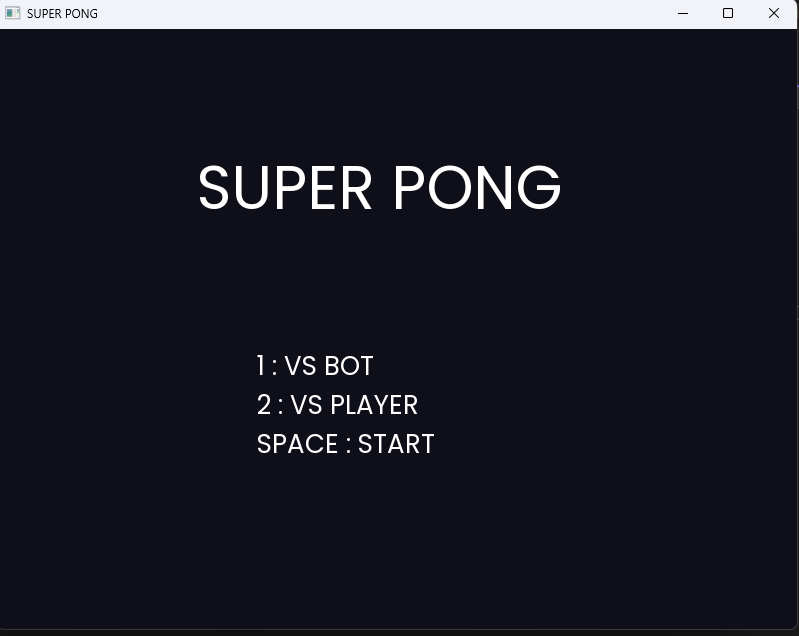
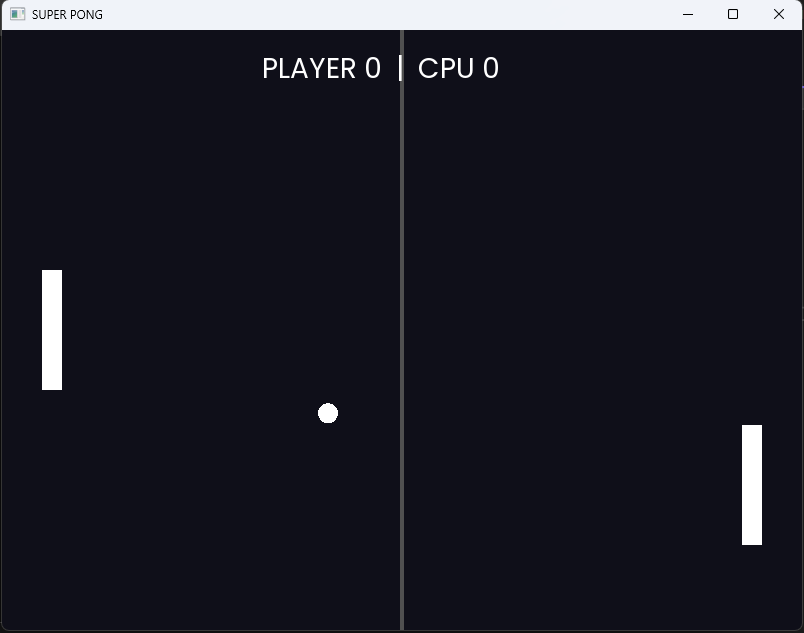

# 🏓 Super Pong

Un Pong classique développé en C++ moderne avec SFML 3 : deux modes de jeu, physique de rebond dynamique et effets de particules à chaque collision.

## 🎮 Fonctionnalités

- **Deux modes de jeu** : contre un bot (`VS_BOT`) ou en local à deux joueurs (`VS_PLAYER`)
- **Physique de rebond dynamique** : l'angle de la balle change selon l'endroit où elle touche la raquette
- **Effets de particules** : retour visuel à chaque impact sur une raquette
- **Système de score** : premier à 11 points gagne
- **Machine à états** : Menu → Jeu → Game Over

## 📸 Aperçu

| Écran d'accueil | En jeu |
|---|---|
|  |  |

## 🎯 Contrôles

| Action | Joueur 1 | Joueur 2 (mode `VS_PLAYER`) |
|---|---|---|
| Monter | `Z` | `↑` |
| Descendre | `S` | `↓` |
| Quitter | `Échap` | — |

## 🚀 Installation

### Prérequis

- Visual Studio 2022 (ou plus récent) avec le workload "Développement Desktop en C++"
- [SFML 3](https://www.sfml-dev.org/)

### Compilation

1. Cloner le dépôt
   ```bash
   git clone https://github.com/Personal-Projects-Archive/super-pong-sfml.git
   ```
2. Ouvrir la solution dans Visual Studio
3. Vérifier que SFML 3 est bien lié (include/lib + DLLs à côté de l'exécutable)
4. Compiler et lancer (F5)

## 🧠 Ce que j'ai appris

- Mettre en place une machine à états pour gérer le déroulement du jeu (Menu / Jeu / Game Over)
- Structurer le code pour gérer séparément les événements et les actions en jeu
- Implémenter un système de collision précis et un rebond de la balle qui varie selon l'endroit où elle touche la raquette
- Construire un petit système de particules pour du feedback visuel

## 👤 Auteur

**Yassine El Yazami**
Étudiant en Automatisation (EPHEC Tech)